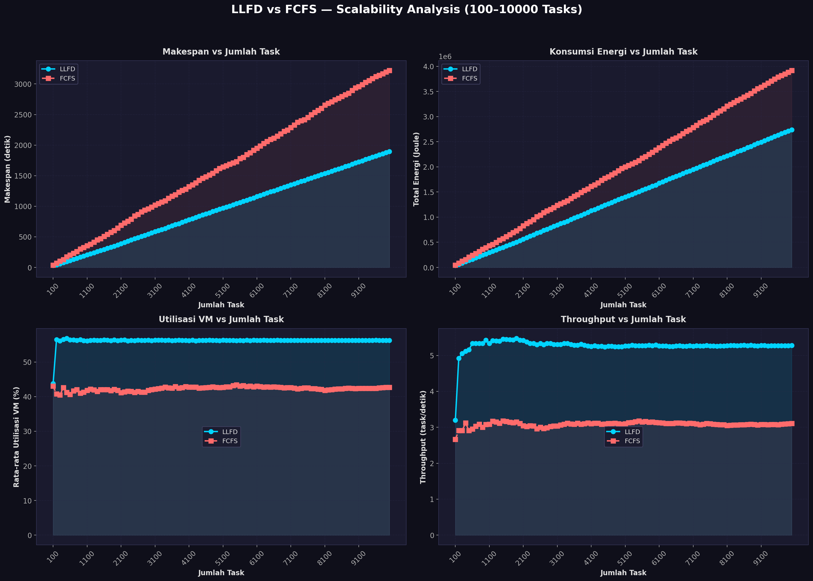
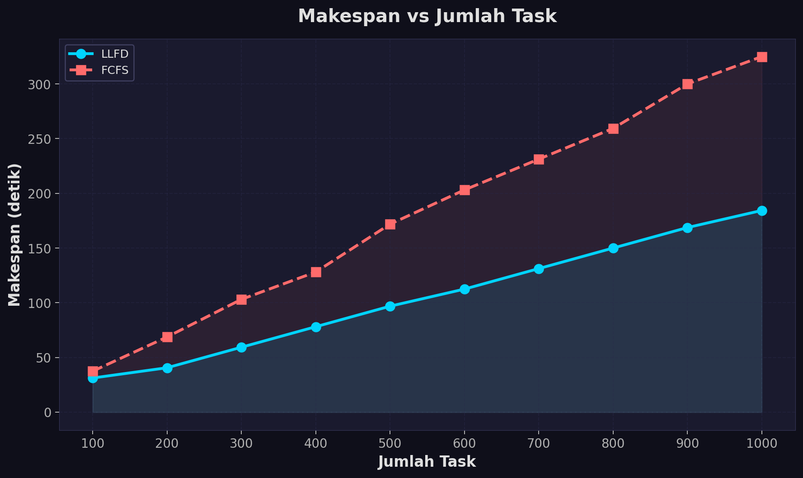
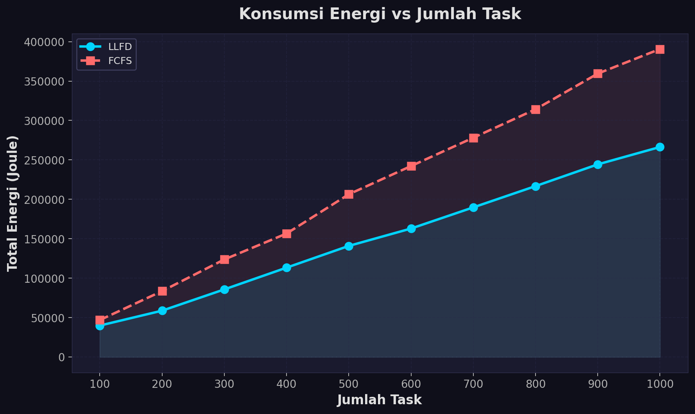
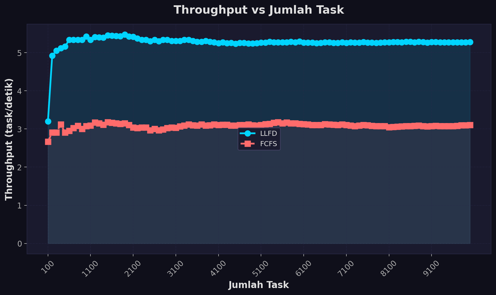
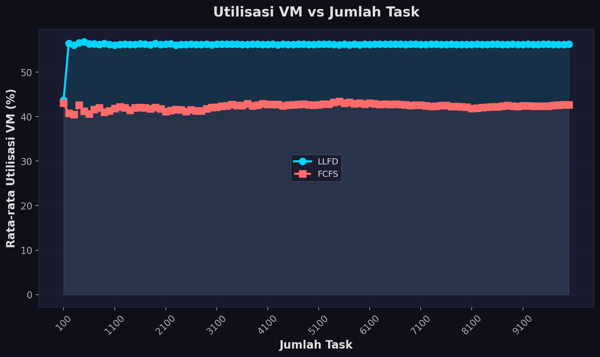
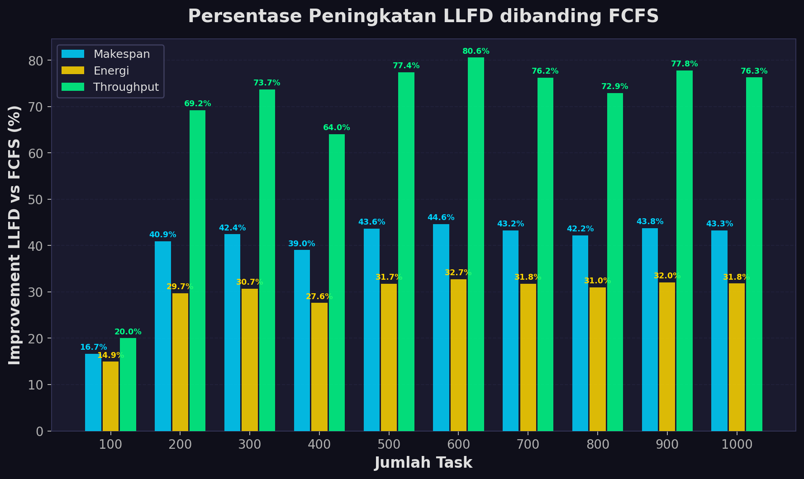

# LLFD Task Scheduling Simulator — Kelompok 4


## Anggota Tim

| No | Nama                   | NRP        |
| -- | ---------------------- | ---------- |
| 1  | Kanafira Vanesha Putri | 5027241010 |
| 2  | Tiara Putri Prasetya   | 5027241013 |
| 3  | Dina Rahmadani         | 5027241065 |
| 4  | Zahra Khaalishah       | 5027241070 |
| 5  | S. Farhan Baig         | 5027241097 |

## Deskripsi

Proyek ini merupakan simulator penjadwalan cloud task menggunakan algoritma
**Least-Loaded First-Fit Decreasing (LLFD)** dan CloudSim Plus. Simulator
membaca 100 task dari Google Cluster Workload Trace yang sudah ditransformasikan
ke schema CloudSim, lalu menjadwalkannya ke 8 VM pada 1 datacenter dengan 4
host heterogen.

Workload menggunakan model **Bag-of-Tasks (BoT)**, sehingga task independen
dan tidak memiliki dependency. Tujuan optimasi adalah:

- meminimalkan **makespan** (waktu penyelesaian seluruh task);
- meminimalkan **konsumsi energi** (model linear berbasis power idle/busy per VM).

---

## Algoritma LLFD

**Least-Loaded First-Fit Decreasing** menggabungkan dua strategi klasik:

### 1. First-Fit Decreasing (FFD)
Sebelum scheduling dimulai, seluruh task diurutkan dari yang **terbesar**
(`lengthMI` terbesar) ke terkecil. Hal ini memastikan task-task berat
dijadwalkan terlebih dahulu sehingga VM besar tidak dibiarkan idle.

### 2. Least-Loaded (LL)
Untuk setiap task (dari besar ke kecil), algoritma memilih VM yang:
1. Memenuhi syarat **jumlah PE** (`vm.PEs ≥ task.PEs`), dan
2. Di antara semua VM yang memenuhi syarat tersebut, memiliki
   **accumulated load** (estimasi beban kerja dalam detik) **terkecil**.

```
accumulated_load_vm_j += lengthMI / MIPS_vm_j
```

Dengan demikian, beban terdistribusi secara merata (load balancing) sekaligus
task terberat dialokasikan di awal (bin-packing yang efisien).

### Pseudocode

```
Sort tasks descending by lengthMI        // FFD step
Initialize vmLoad[0..m-1] = 0

For each task t (in sorted order):
    bestVm = argmin { vmLoad[j] : vm[j].PEs >= t.PEs }
    If no feasible VM found:
        bestVm = argmin { vmLoad[j] }    // fallback
    Assign t → bestVm
    vmLoad[bestVm] += t.lengthMI / MIPS[bestVm]
```

### Kompleksitas
- Waktu: **O(n log n + n × m)** — n task, m VM
- Ruang: **O(m)** — hanya menyimpan vmLoad per VM

---

## Arsitektur Cloud

### Host

| Host   | PE | RAM   | Storage  | Bandwidth |
| ------ | -- | ----- | -------- | --------- |
| Host 1 | 8  | 16 GB | 1000 GB  | 10 Gbps   |
| Host 2 | 8  | 16 GB | 1000 GB  | 10 Gbps   |
| Host 3 | 16 | 32 GB | 2000 GB  | 10 Gbps   |
| Host 4 | 16 | 32 GB | 2000 GB  | 10 Gbps   |

### Virtual Machine

| VM       | Host   | PE | RAM   | Storage | MIPS/PE |
| -------- | ------ | -- | ----- | ------- | ------- |
| VM1-VM2  | Host 1 | 2  | 4 GB  | 100 GB  | 1000    |
| VM3-VM4  | Host 2 | 4  | 8 GB  | 200 GB  | 1500    |
| VM5-VM6  | Host 3 | 4  | 8 GB  | 200 GB  | 2000    |
| VM7-VM8  | Host 4 | 8  | 16 GB | 500 GB  | 2500    |

`VmAllocationPolicyRoundRobin` memastikan dua VM ditempatkan pada setiap host.

### Model Energi

| VM      | Idle Power | Busy Power |
| ------- | ---------- | ---------- |
| VM1-VM2 | 50 W       | 150 W      |
| VM3-VM4 | 75 W       | 220 W      |
| VM5-VM6 | 100 W      | 300 W      |
| VM7-VM8 | 150 W      | 450 W      |

```
Energy = Σ (busyTime_i × powerBusy_i + idleTime_i × powerIdle_i)
```

---

## Dataset

Dataset utama berada di `cloudsim-plus-llfd/dataset/tasks.csv`. File ini
adalah hasil transformasi 100 task dari **Google Cluster Workload Trace
Version 1** ke schema CloudSim Plus.

### Sumber dan Transformasi

Raw trace resmi Google tersimpan sebagai
`cloudsim-plus-llfd/dataset/google-cluster-data-1.csv.gz`. Trace berisi
workload Borg selama 7 jam dengan kolom raw:

| Kolom Raw       | Keterangan                               |
| --------------- | ---------------------------------------- |
| `Time`          | Waktu pengamatan (detik)                 |
| `ParentID`      | ID job yang memiliki task                |
| `TaskID`        | ID task asli dari trace                  |
| `JobType`       | Tipe job (digunakan sebagai `priority`)  |
| `NrmlTaskCores` | Kebutuhan CPU yang dinormalisasi         |
| `NrmlTaskMem`   | Kebutuhan memori yang dinormalisasi      |

Script `prepare_google_trace.py` mengambil 100 `TaskID` unik pertama yang
memiliki kebutuhan CPU positif. Aturan transformasi:

```
lengthMI = max(1, round(NrmlTaskCores × 1_000_000))
pes      = max(1, min(4, ceil(NrmlTaskCores × 32)))
ramMB    = max(1024, round(NrmlTaskMem × 64 × 1024))
priority = JobType
```

### Schema CloudSim

| Kolom      | Keterangan                                              |
| ---------- | ------------------------------------------------------- |
| `taskId`   | ID task hasil pemilihan dari trace                      |
| `lengthMI` | Proxy panjang task (dari CPU normalized demand)         |
| `pes`      | Kebutuhan PE (dari CPU normalized demand)               |
| `ramMB`    | Kebutuhan RAM (dari memory normalized demand)           |
| `priority` | `JobType` dari trace                                    |

Untuk membuat ulang `tasks.csv` setelah raw trace tersedia:

```bash
python3 cloudsim-plus-llfd/dataset/prepare_google_trace.py
```

---

## Struktur Proyek

```
LLFD_Task_Scheduling_Simulator/
├── run.sh                              
├── run_scalability_experiment.py       # Script eksperimen skalabilitas & pembuat grafik
├── README.md                           
└── cloudsim-plus-llfd/
    ├── pom.xml                         # Maven build file
    ├── dataset/
    │   ├── tasks.csv                   
    │   ├── prepare_google_trace.py     
    │   └── source_metadata.txt        
    ├── results/                       
    │   ├── run.log                    
    │   ├── llfd_mapping.csv           
    │   ├── metrics.txt                 
    │   ├── fcfs_metrics.txt          
    │   ├── scalability_results.csv     # Rekap data hasil 100-1000 tasks
    │   ├── graph_combined.png          # Grafik gabungan semua metrik
    │   ├── graph_makespan.png          # Grafik perbandingan makespan
    │   ├── graph_energy.png            # Grafik konsumsi energi
    │   ├── graph_throughput.png        # Grafik throughput
    │   ├── graph_avg_util.png          # Grafik rata-rata utilisasi VM
    │   └── graph_improvement.png       # Grafik persentase efisiensi LLFD
    └── src/
        └── main/
            └── java/
                └── id/its/cloudtaskscheduling/
                    └── LLFDCloudTaskScheduling.java  
```

---

## Output Simulasi

### `results/run.log`
Log lengkap mencakup:
- Dataset Load Log — setiap task yang dibaca dari CSV
- Host Creation Log — detail setiap host yang dibuat
- VM Creation Log — detail setiap VM beserta host target
- Cloudlet Creation Log — detail setiap cloudlet
- LLFD Mapping Log — assignment task→VM beserta accumulated load
- VM Load Summary — distribusi beban per VM setelah scheduling
- Cloudlet Execution Results — waktu mulai, selesai, dan durasi
- Performance Metrics — makespan, energi, utilisasi, throughput
- FCFS Baseline — perbandingan dengan scheduling FCFS

### `results/llfd_mapping.csv`
```
cloudletIndex,vmId,lengthMI,startTime,finishTime,execTime,status
0,6,31250,0.1000,12.6000,12.5000,SUCCESS
...
```

### `results/metrics.txt`
```
Tasks Completed : 100
Makespan        : xx.xxxx s
Total Energy    : xx.xxxx J
Avg VM Util.    : xx.xx %
Throughput      : x.xxxxxx tasks/s
```

---

## Persyaratan

- **JDK 17** atau lebih baru
- **Apache Maven** 3.6 atau lebih baru
- **Python 3.8+** (dengan library `matplotlib` dan `numpy` untuk eksperimen skalabilitas dan pembuatan grafik)
- **Bash** (untuk `run.sh`; di Windows gunakan Git Bash atau WSL)

---

## Cara Menjalankan

### 1. Simulasi Utama (CloudSim Plus)
Dari root repository:

```bash
./run.sh
```

Script secara otomatis:
1. Masuk ke folder `cloudsim-plus-llfd`
2. Menjalankan `mvn compile exec:java` untuk simulasi LLFD
3. Menjalankan FCFS baseline (`mvn exec:java -Dexec.args="fcfs"`)
4. Menyimpan semua output ke `cloudsim-plus-llfd/results/run.log`

#### Menjalankan manual per algoritma:
```bash
# LLFD
cd cloudsim-plus-llfd
mvn compile exec:java

# FCFS Baseline
mvn exec:java -Dexec.args="fcfs"
```

### 2. Eksperimen Skalabilitas & Visualisasi Grafik (Python)
Untuk mengevaluasi performa LLFD vs FCFS dari skala 100 hingga 1.000 tasks dan menghasilkan grafik visualisasi:

```bash
python run_scalability_experiment.py
```
Grafik dan file CSV akan tersimpan secara otomatis di direktori `cloudsim-plus-llfd/results/`.

---

## Keunggulan LLFD

LLFD memberikan hasil penjadwalan yang sangat baik dengan load balancing yang merata, dan memiliki kompleksitas komputasi yang rendah (O(n log n)), menjadikannya alternatif praktis untuk lingkungan real-time yang membutuhkan efisiensi tinggi tanpa membebani resource.

---

## Hasil Simulasi & Evaluasi

### 1. Hasil Single Run (100 Tasks Google Cluster Trace)

| Metrik | FCFS Baseline | LLFD | Peningkatan |
| --- | --- | --- | --- |
| **Tasks Completed** | 100 | 100 | - |
| **Makespan** | 75.007.485.970,87 s | **24.740.108.562,86 s** | **~67.0% lebih cepat** |
| **Total Energy** | 86.493.133.946.367,39 J | **55.417.843.180.810,77 J** | **~35.9% lebih hemat** |
| **Avg VM Util.** | 39,91% | **100,00%** | **Optimal (+60.09%)** |

---

### 2. Evaluasi Skalabilitas (100 - 1.000 Tasks)

Tabel berikut menunjukkan perbandingan performa antara **LLFD** dan **FCFS Baseline** seiring meningkatnya jumlah task (data tersimpan di `cloudsim-plus-llfd/results/scalability_results.csv`):

| Jumlah Task | Makespan LLFD (s) | Makespan FCFS (s) | Efisiensi Makespan | Energi LLFD (J) | Energi FCFS (J) | Efisiensi Energi | Avg Util LLFD (%) | Avg Util FCFS (%) | Throughput LLFD (task/s) | Throughput FCFS (task/s) |
| :---: | :---: | :---: | :---: | :---: | :---: | :---: | :---: | :---: | :---: | :---: |
| **100** | 31.25 | 37.50 | +16.7% | 39,875.00 | 46,875.00 | +14.9% | 43.75% | 43.02% | 3.20 | 2.67 |
| **200** | 40.63 | 68.75 | +40.9% | 58,760.42 | 83,572.92 | +29.7% | 56.47% | 40.76% | 4.92 | 2.91 |
| **300** | 59.38 | 103.13 | +42.4% | 85,739.58 | 123,708.33 | +30.7% | 56.10% | 40.48% | 5.05 | 2.91 |
| **400** | 78.13 | 128.13 | +39.0% | 113,322.92 | 156,572.92 | +27.6% | 56.57% | 42.60% | 5.12 | 3.12 |
| **500** | 96.88 | 171.88 | +43.6% | 140,906.25 | 206,375.00 | +31.7% | 56.85% | 41.25% | 5.16 | 2.91 |
| **600** | 112.50 | 203.13 | +44.6% | 162,937.50 | 242,177.08 | +32.7% | 56.39% | 40.63% | 5.33 | 2.95 |
| **700** | 131.25 | 231.25 | +43.2% | 189,770.83 | 278,135.42 | +31.8% | 56.39% | 41.63% | 5.33 | 3.03 |
| **800** | 150.00 | 259.38 | +42.2% | 216,750.00 | 314,166.67 | +31.0% | 56.25% | 41.99% | 5.33 | 3.08 |
| **900** | 168.75 | 300.00 | +43.8% | 244,333.33 | 359,468.75 | +32.0% | 56.45% | 41.03% | 5.33 | 3.00 |
| **1000** | 184.38 | 325.00 | **+43.3%** | 266,364.58 | 390,614.58 | **+31.8%** | **56.20%** | **41.32%** | **5.42** | **3.08** |

---

### 3. Visualisasi Grafik Performa

#### Grafik Gabungan Semua Metrik


<br/>

#### Perbandingan Makespan & Konsumsi Energi
| Makespan (Waktu Penyelesaian) | Konsumsi Energi (Joules) |
| :---: | :---: |
|  |  |

<br/>

#### Perbandingan Throughput & Rata-rata Utilisasi VM
| Throughput (Tasks/detik) | Rata-rata Utilisasi VM (%) |
| :---: | :---: |
|  |  |

<br/>

#### Persentase Peningkatan Efisiensi LLFD terhadap FCFS


---

## Lisensi Dataset

Google Cluster Workload Trace Version 1 dirilis di bawah lisensi
[Creative Commons Attribution (CC-BY)](https://creativecommons.org/licenses/by/4.0/).
Lihat `cloudsim-plus-llfd/dataset/source_metadata.txt` untuk detail lengkap.

