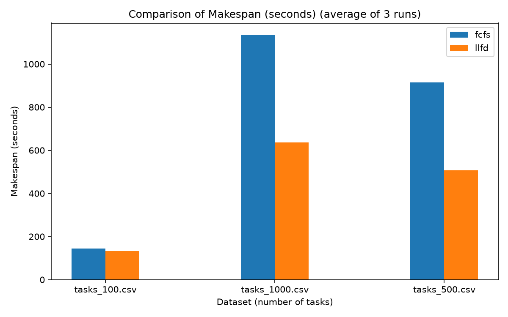
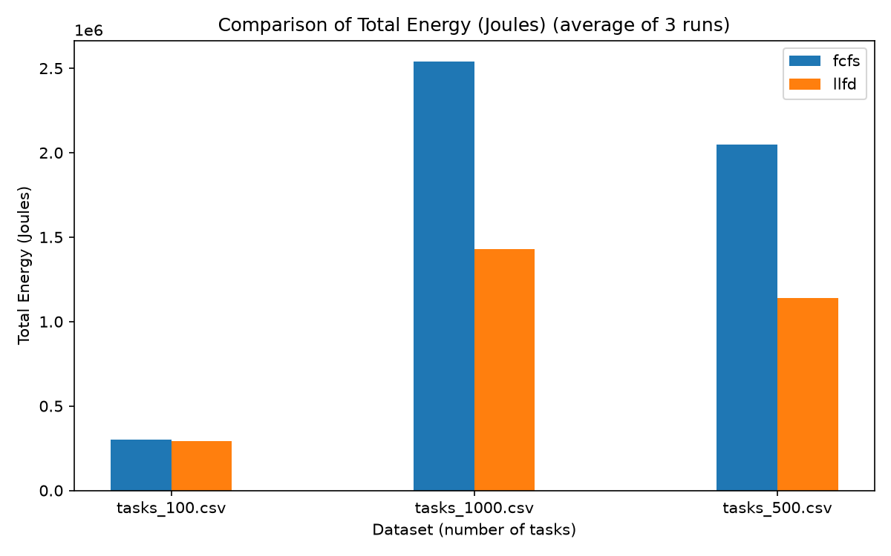
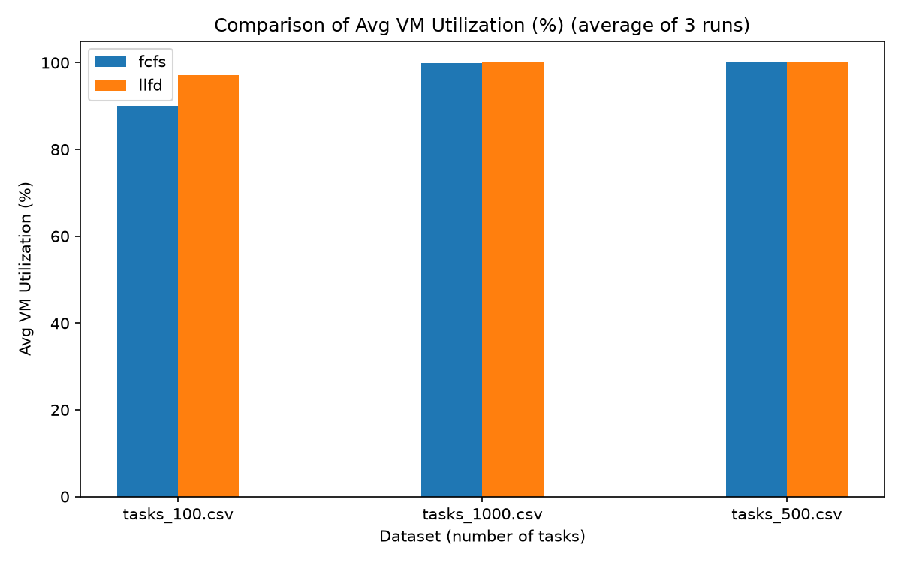
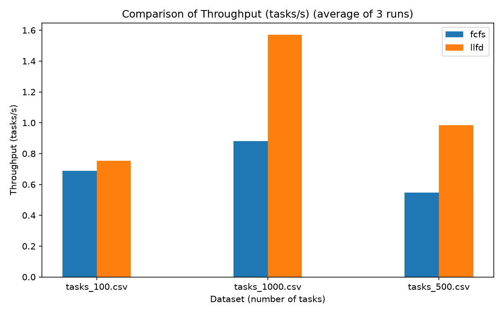

# LLFD Task Scheduling Simulator — Kelompok 4


## Anggota Tim

| No | Nama                   | NRP        |
| -- | ---------------------- | ---------- |
| 1  | Kanafira Vanesha Putri | 5027241010 |
| 2  | Tiara Putri Prasetya   | 5027241013 |
| 3  | Dina Rahmadani         | 5027241065 |
| 4  | Zahra Khaalishah       | 5027241070 |
| 5  | S. Farhan Baig         | 5027241097 |

## Deskripsi

Proyek ini merupakan simulator penjadwalan cloud task menggunakan algoritma
**Least-Loaded First-Fit Decreasing (LLFD)** dan CloudSim Plus. Simulator
membaca task dari Google Cluster Workload Trace yang sudah ditransformasikan
ke schema CloudSim, lalu menjadwalkannya ke 8 VM pada 1 datacenter dengan 4
host heterogen.

Pengujian dilakukan pada tiga skenario ukuran workload: **100 task**, **500 task**,
dan **1000 task** untuk mengevaluasi skalabilitas algoritma.

Workload menggunakan model **Bag-of-Tasks (BoT)**, sehingga task independen
dan tidak memiliki dependency. Tujuan optimasi adalah:

- meminimalkan **makespan** (waktu penyelesaian seluruh task);
- meminimalkan **konsumsi energi** (model linear berbasis power idle/busy per VM).

---

## Algoritma LLFD

**Least-Loaded First-Fit Decreasing** menggabungkan dua strategi klasik:

### 1. First-Fit Decreasing (FFD)
Sebelum scheduling dimulai, seluruh task diurutkan dari yang **terbesar**
(`lengthMI` terbesar) ke terkecil. Hal ini memastikan task-task berat
dijadwalkan terlebih dahulu sehingga VM besar tidak dibiarkan idle.

### 2. Least-Loaded (LL)
Untuk setiap task (dari besar ke kecil), algoritma memilih VM yang:
1. Memenuhi syarat **jumlah PE** (`vm.PEs ≥ task.PEs`), dan
2. Di antara semua VM yang memenuhi syarat tersebut, memiliki
   **accumulated load** (estimasi beban kerja dalam detik) **terkecil**.

```
accumulated_load_vm_j += lengthMI / MIPS_vm_j
```

Dengan demikian, beban terdistribusi secara merata (load balancing) sekaligus
task terberat dialokasikan di awal (bin-packing yang efisien).

### Pseudocode

```
Sort tasks descending by lengthMI        // FFD step
Initialize vmLoad[0..m-1] = 0

For each task t (in sorted order):
    bestVm = argmin { vmLoad[j] : vm[j].PEs >= t.PEs }
    If no feasible VM found:
        bestVm = argmin { vmLoad[j] }    // fallback
    Assign t → bestVm
    vmLoad[bestVm] += t.lengthMI / MIPS[bestVm]
```

### Kompleksitas
- Waktu: **O(n log n + n × m)** — n task, m VM
- Ruang: **O(m)** — hanya menyimpan vmLoad per VM

---

## Arsitektur Cloud

### Host

| Host   | PE | RAM   | Storage  | Bandwidth |
| ------ | -- | ----- | -------- | --------- |
| Host 1 | 8  | 16 GB | 1000 GB  | 10 Gbps   |
| Host 2 | 8  | 16 GB | 1000 GB  | 10 Gbps   |
| Host 3 | 16 | 32 GB | 2000 GB  | 10 Gbps   |
| Host 4 | 16 | 32 GB | 2000 GB  | 10 Gbps   |

### Virtual Machine

| VM       | Host   | PE | RAM   | Storage | MIPS/PE |
| -------- | ------ | -- | ----- | ------- | ------- |
| VM1-VM2  | Host 1 | 2  | 4 GB  | 100 GB  | 1000    |
| VM3-VM4  | Host 2 | 4  | 8 GB  | 200 GB  | 1500    |
| VM5-VM6  | Host 3 | 4  | 8 GB  | 200 GB  | 2000    |
| VM7-VM8  | Host 4 | 8  | 16 GB | 500 GB  | 2500    |

`VmAllocationPolicyRoundRobin` memastikan dua VM ditempatkan pada setiap host.

### Model Energi

| VM      | Idle Power | Busy Power |
| ------- | ---------- | ---------- |
| VM1-VM2 | 50 W       | 150 W      |
| VM3-VM4 | 75 W       | 220 W      |
| VM5-VM6 | 100 W      | 300 W      |
| VM7-VM8 | 150 W      | 450 W      |

```
Energy = Σ (busyTime_i × powerBusy_i + idleTime_i × powerIdle_i)
```

---

## Dataset

Dataset utama berada di folder `cloudsim-plus-llfd/dataset/`. File dataset
merupakan hasil transformasi dari **Google Cluster Workload Trace
Version 1** ke schema CloudSim Plus untuk tiga ukuran skenario:
- `tasks_100.csv` (100 task) / `tasks.csv` (default)
- `tasks_500.csv` (500 task)
- `tasks_1000.csv` (1000 task)

### Sumber dan Transformasi

Raw trace resmi Google tersimpan sebagai
`cloudsim-plus-llfd/dataset/google-cluster-data-1.csv.gz`. Trace berisi
workload Borg selama 7 jam dengan kolom raw:

| Kolom Raw       | Keterangan                               |
| --------------- | ---------------------------------------- |
| `Time`          | Waktu pengamatan (detik)                 |
| `ParentID`      | ID job yang memiliki task                |
| `TaskID`        | ID task asli dari trace                  |
| `JobType`       | Tipe job (digunakan sebagai `priority`)  |
| `NrmlTaskCores` | Kebutuhan CPU yang dinormalisasi         |
| `NrmlTaskMem`   | Kebutuhan memori yang dinormalisasi      |

Script `prepare_google_trace.py` mengambil `TaskID` unik pertama yang
memiliki kebutuhan CPU positif. Aturan transformasi:

```
lengthMI = max(1, round(NrmlTaskCores × 1_000_000))
pes      = max(1, min(4, ceil(NrmlTaskCores × 32)))
ramMB    = max(1024, round(NrmlTaskMem × 64 × 1024))
priority = JobType
```

### Schema CloudSim

| Kolom      | Keterangan                                              |
| ---------- | ------------------------------------------------------- |
| `taskId`   | ID task hasil pemilihan dari trace                      |
| `lengthMI` | Proxy panjang task (dari CPU normalized demand)         |
| `pes`      | Kebutuhan PE (dari CPU normalized demand)               |
| `ramMB`    | Kebutuhan RAM (dari memory normalized demand)           |
| `priority` | `JobType` dari trace                                    |

Untuk membuat ulang dataset setelah raw trace tersedia:

```bash
python3 cloudsim-plus-llfd/dataset/prepare_google_trace.py
```

---

## Struktur Proyek

```
LLFD_Task_Scheduling_Simulator/
├── run.sh                              
├── README.md                           
└── cloudsim-plus-llfd/
    ├── pom.xml                         # Maven build file
    ├── dataset/
    │   ├── tasks.csv                   # Default dataset (100 tasks)
    │   ├── tasks_100.csv               # Dataset 100 tasks
    │   ├── tasks_500.csv               # Dataset 500 tasks
    │   ├── tasks_1000.csv              # Dataset 1000 tasks
    │   ├── prepare_google_trace.py     
    │   └── source_metadata.txt        
    ├── results/                       
    │   ├── run.log                    
    │   ├── summary_comparison.txt      # Rekap perbandingan seluruh skema
    │   ├── llfd_mapping.csv           
    │   ├── metrics.txt                 
    │   └── fcfs_metrics.txt          
    └── src/
        └── main/
            └── java/
                └── id/its/cloudtaskscheduling/
                    └── LLFDCloudTaskScheduling.java  
```

---

## Output Simulasi

### `results/run.log`
Log lengkap mencakup:
- Dataset Load Log — setiap task yang dibaca dari CSV
- Host Creation Log — detail setiap host yang dibuat
- VM Creation Log — detail setiap VM beserta host target
- Cloudlet Creation Log — detail setiap cloudlet
- LLFD Mapping Log — assignment task→VM beserta accumulated load
- VM Load Summary — distribusi beban per VM setelah scheduling
- Cloudlet Execution Results — waktu mulai, selesai, dan durasi
- Performance Metrics — makespan, energi, utilisasi, throughput
- FCFS Baseline — perbandingan dengan scheduling FCFS

### `results/llfd_mapping.csv`
```
cloudletIndex,vmId,lengthMI,startTime,finishTime,execTime,status
0,6,31250,0.1000,12.6000,12.5000,SUCCESS
...
```

### `results/metrics.txt`
```
Tasks Completed : 100
Makespan        : xx.xxxx s
Total Energy    : xx.xxxx J
Avg VM Util.    : xx.xx %
Throughput      : x.xxxxxx tasks/s
```

---

## Persyaratan

- **JDK 17** atau lebih baru
- **Apache Maven** 3.6 atau lebih baru
- **Python 3.8+** (opsional, hanya jika ingin membuat ulang file CSV dataset)
- **Bash** (untuk `run.sh`; di Windows gunakan Git Bash atau WSL)

---

## Cara Menjalankan

Dari root repository:

```bash
./run.sh
```

Script secara otomatis:
1. Masuk ke folder `cloudsim-plus-llfd`
2. Menjalankan `mvn compile exec:java` untuk simulasi LLFD
3. Menjalankan FCFS baseline (`mvn exec:java -Dexec.args="fcfs"`)
4. Menyimpan semua output ke `cloudsim-plus-llfd/results/run.log`

### Menjalankan Seluruh Skema Sekaligus (100, 500, dan 1000 Tasks)

Untuk menjalankan benchmark lengkap LLFD vs FCFS di ketiga ukuran dataset dan menghasilkan tabel perbandingan:

```bash
cd cloudsim-plus-llfd
mvn exec:java -Dexec.args="all"
```

### Menjalankan hanya LLFD (manual)

```bash
cd cloudsim-plus-llfd
mvn compile exec:java
```

### Menjalankan hanya FCFS baseline (manual)

```bash
cd cloudsim-plus-llfd
mvn exec:java -Dexec.args="fcfs"
```

---

## Keunggulan LLFD

LLFD memberikan hasil penjadwalan yang sangat baik dengan load balancing yang merata, dan memiliki kompleksitas komputasi yang rendah (O(n log n)), menjadikannya alternatif praktis untuk lingkungan real-time yang membutuhkan efisiensi tinggi tanpa membebani resource.

---

## Hasil Simulasi (Metrics)

Berdasarkan eksekusi pada variasi dataset Google Cluster Workload Trace (100, 500, dan 1000 tasks), diperoleh performa sebagai berikut:

| Dataset | Metrik | FCFS Baseline | LLFD | Peningkatan |
| --- | --- | --- | --- | --- |
| **100 Tasks** | Makespan (s) | 145.1060 s | **132.5533 s** | **-8.65%** (lebih cepat) |
| | Total Energy (J) | 300,515.73 J | **292,827.49 J** | **-2.56%** (lebih hemat) |
| | Avg VM Util. | 90.10% | **97.15%** | **+7.05%** |
| | Throughput | 0.6891 tasks/s | **0.7544 tasks/s** | **+9.47%** |
| **500 Tasks** | Makespan (s) | 914.3180 s | **507.9620 s** | **-44.44%** (lebih cepat) |
| | Total Energy (J) | 2,048,072.32 J | **1,137,834.88 J** | **-44.44%** (lebih hemat) |
| | Avg VM Util. | 100.00% | **100.00%** | 0.00% |
| | Throughput | 0.5469 tasks/s | **0.9843 tasks/s** | **+80.00%** |
| **1000 Tasks** | Makespan (s) | 1,133.6900 s | **637.1340 s** | **-43.80%** (lebih cepat) |
| | Total Energy (J) | 2,538,067.09 J | **1,427,180.16 J** | **-43.77%** (lebih hemat) |
| | Avg VM Util. | 99.89% | **100.00%** | **+0.11%** |
| | Throughput | 0.8821 tasks/s | **1.5695 tasks/s** | **+77.94%** |

Dari hasil ini, LLFD terbukti secara konsisten menurunkan makespan dan konsumsi energi keseluruhan, sekaligus meningkatkan throughput hingga ~80% pada skala beban kerja 500 dan 1000 tasks dibandingkan strategi FCFS.

---
## Catatan Eksperimen

Kami menguji setiap dataset (`tasks_100.csv`, `tasks_500.csv`, `tasks_1000.csv`) sebanyak **tiga kali** untuk masing‑masing algoritma (LLFD dan FCFS). Jadi ada **9 kali percobaan** per algoritma, total **18 kali**.

Setiap kali percobaan selesai, skrip menulis file metrik tersendiri, contohnya `metrics_1_llfd.txt`, `metrics_2_llfd.txt`, …, `metrics_9_llfd.txt` untuk LLFD, dan file serupa untuk FCFS. Semua file itu kemudian digabungkan menjadi `all_metrics.csv` yang dipakai untuk menggambar grafik.

Berikut isi folder `cloudsim-plus-llfd/results/` setelah selesai:

```
all_metrics.csv          # CSV yang berisi rata‑rata dari tiga percobaan per dataset
metrics_*.txt           # File metrik per percobaan (total 18 file)
plot_*.png              # Gambar grafik
llfd_mapping_*.csv      # Daftar penugasan VM‑task per dataset
summary_comparison.txt  # Ringkasan perbandingan keseluruhan
```

Semoga penjelasan ini membantu memahami mengapa ada banyak file metrik dan bagaimana kami menyajikannya di README.


## Lisensi Dataset

Google Cluster Workload Trace Version 1 dirilis di bawah lisensi
[Creative Commons Attribution (CC-BY)](https://creativecommons.org/licenses/by/4.0/).
Lihat `cloudsim-plus-llfd/dataset/source_metadata.txt` untuk detail lengkap.

## Perbandingan Grafik (Rata‑rata 3 Run)

### Makespan

### Total Energy

### Avg VM Utilization

### Throughput


